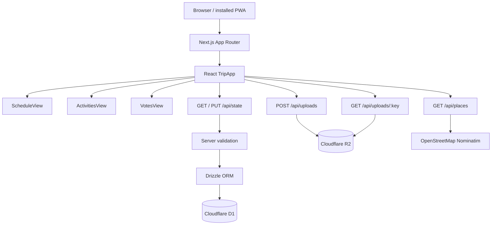

# ARCHITECTURE.md

**Purpose:** Describe how Trip Together currently works at code and deployment level.  
**Current status:** Current application architecture verified against `main`; live deployment differences are called out separately.  
**Last verified:** 2026-10-25

## 1. Source-of-truth boundary

The repository currently has two relevant realities:

1. **`main`** — accepted public application checkpoint and highest-priority source for product code. It contains anonymous demo data and the canonical core UI/business logic.
2. **Current independent deployment** — built from `migration/independent-cloudflare`, which is based on the same core app but adds strict runtime configuration, independent Wrangler configuration, migration/restore tooling and a Cloudflare Workers deployment path that omits the ChatGPT Sites plugin.

Do not infer current production behavior from an old branch without checking this distinction.

## 2. Current Architecture



### Current stack

| Concern | Current implementation |
| --- | --- |
| Frontend | React 19 client UI |
| Framework | Next.js 16 App Router |
| Language | TypeScript |
| Main client component | `components/trip-app.tsx` |
| API/backend | Next.js Route Handlers under `app/api/` |
| ORM | Drizzle ORM with D1 adapter |
| Shared database | Cloudflare D1 |
| Uploaded photo storage | Cloudflare R2 |
| Build/runtime adapter | Vinext + Vite |
| Current independent hosting | Cloudflare Workers |
| Invitation mechanism | Shared private token sent as `x-trip-invite` |
| Member identity | User-selected member ID stored in browser localStorage; not authenticated identity |

## 3. Frontend structure

### Routes

`app/page.tsx` renders the main `TripApp` directly.

`app/join/[token]/page.tsx` is the invitation entry route. It passes the route token into `TripApp`, which remembers it in browser localStorage.

### The three main screens are not routes

The following product surfaces are React views selected by local component state:

- `ScheduleView` — 每日行程
- `ActivitiesView` — 活動籃子
- `VotesView` — 投票與邀請

`TripApp` holds `section: "schedule" | "activities" | "votes"` and conditionally renders one view. Changing tabs does not navigate to a new Next.js page.

### Client state

`TripApp` keeps the loaded `TripState`, current revision, selected member, filters, drafts and dialogs in React state. A write is applied optimistically in the UI, then persisted through `/api/state`.

The browser also stores:

- `trip-together-invite` — remembered invitation token.
- `trip-together-member` — selected member ID.
- `trip-together-offline-state` — last known TripState for read fallback when state loading fails.

See [DATABASE.md](DATABASE.md) for the full storage boundary.

## 4. API architecture

| Endpoint | Methods | Responsibility |
| --- | --- | --- |
| `/api/state` | `GET`, `PUT` | Load and replace the shared trip state; enforce invite token, revision checks, schedule range validation and changed-conflict validation. |
| `/api/uploads` | `POST` | Accept JPG/PNG/WebP up to 5 MB and store it in R2. |
| `/api/uploads/[key]` | `GET`, `DELETE` | Read an R2 object by generated key; delete requires the invite token. |
| `/api/places` | `GET` | Authenticated proxy to OpenStreetMap Nominatim, currently constrained to Australia. |

The application does not currently expose a normalized REST resource API for members, activities or itinerary items. Most domain changes are sent as one complete TripState document to `/api/state`.

## 5. Shared-state data flow

Example: a member adds or edits an itinerary item.

```text
User action
  ↓
TripApp builds next TripState in memory
  ↓
Optimistic React state + local offline cache update
  ↓
PUT /api/state
  { state: nextState, revision: currentRevision }
  ↓
Invite check
  ↓
Current D1 row read
  ↓
Revision equality check
  ↓
Schedule-range + changed-conflict validation
  ↓
Compare-and-swap D1 update (trip_id + old revision)
  ↓
revision + 1 returned to browser
```

If another writer has already changed the row, the API returns `409` with `stale_revision`. The client then attempts to reload authoritative state so a rejected local edit does not remain visible.

This is optimistic concurrency control, not realtime collaboration. Other devices do not receive server-pushed changes; they need a fresh load/reload to obtain changes made elsewhere.

## 6. Photo flow

```text
Activity editor
  ↓
POST multipart/form-data /api/uploads
  ↓
MIME + 5 MB size validation
  ↓
Random UUID-based object key
  ↓
R2 BUCKET
  ↓
/api/uploads/<key> stored inside Activity.image
```

When an uploaded photo is replaced/deleted, the client performs a best-effort DELETE of the old R2 object. D1 state and R2 object deletion are not one atomic transaction, so orphan cleanup is a known operational concern.

## 7. Place search

`/api/places` accepts a text query and optional city, requires the invite header, and forwards a server-side request to OpenStreetMap Nominatim. The current implementation appends `Australia` to the search and returns up to six mapped results plus attribution.

This is an external dependency and should not be treated as core trip storage.

## 8. PWA and offline behavior

`public/sw.js` caches the app shell and non-API GET responses using a network-first strategy. Requests under `/api/` are excluded from service-worker caching.

The client separately keeps the last loaded TripState in localStorage. If `/api/state` fails during initial load, the app can show that cached state. There is no offline mutation queue, conflict merge or guarantee that cached state is current.

## 9. Hosting and deployment architecture

### `main`

`main` remains compatible with the original ChatGPT Sites/local tooling:

- `.openai/hosting.json` declares binding names `DB` and `BUCKET`.
- `vite.config.ts` loads the Sites plugin and simulates local D1/R2 resources through the Cloudflare Vite plugin.
- `app/chatgpt-auth.ts` contains optional Sites/ChatGPT sign-in helpers, but the current TripApp flow does not call them for product identity.

`.openai/hosting.json` is a binding declaration, not a full description of the current live Worker configuration.

### Current independent Cloudflare deployment

The live independent deployment currently builds from `migration/independent-cloudflare`.

That branch adds:

- independent Wrangler configuration;
- `TRIP_DEPLOY_TARGET=independent` build mode;
- omission of the ChatGPT Sites plugin during independent builds;
- strict configuration variables for invite-token availability and storage selection;
- independent build/preflight/dry-run/deploy scripts;
- private migration/restore tooling.

The verified runtime uses Cloudflare Workers with D1 binding `DB`, R2 binding `BUCKET`, and a Worker secret named `TRIP_INVITE_TOKEN`. Private resource identifiers and secret values are intentionally not documented here.

The main architectural risk is that these deployment deltas are not yet merged into `main`. See [PROJECT_STATUS.md](PROJECT_STATUS.md).

## 10. Authentication vs identification

Trip Together currently has **invitation authorization plus member identification**, not true user authentication.

1. Possession of the shared private invite token grants access to the trip APIs.
2. The browser presents the trip member list.
3. The visitor selects a member identity.
4. That selected ID drives client-side UI permissions and vote attribution.

There is no account credential proving that the visitor really is the selected member. In the trusted-family use case this is an accepted current boundary, but it must not be described as account authentication. See [SECURITY.md](SECURITY.md).

## 11. Historical / Experimental Architecture

### Supabase guest-mode spike — not current

Branch: `rebuild/next-supabase-guest-spike`  
Sub-app: `apps/guest-spike`

This was an isolated experiment for a potential next-generation guest/session model using Supabase/PostgreSQL RPCs, bounded guest credentials and more granular server-side permissions. Its own README explicitly states that it was a technical slice rather than the migrated full app.

It did not include the full accepted Trip Together experience such as the complete timeline, basket, voting publication, photo flow, PWA/offline behavior or production data migration. It did not replace the root D1/R2 application.

Treat all Supabase schemas, migrations, environment variables and RPC names on this branch as **Historical / Experimental**, unless a future decision explicitly adopts them.

### ChatGPT Sites hosting — previous hosting path

The accepted public checkpoint still contains Sites-specific build helpers and optional ChatGPT sign-in utilities because the app originated in that environment. The current independent Cloudflare deployment does not require ChatGPT Sites for runtime access.

## 12. Future architecture is not current architecture

Ideas such as normalized relational tables per activity/member, real user accounts, OAuth, native Expo apps, push notifications or a commercial multi-tenant backend are future design directions only. Do not document them as implemented until the code on the active source-of-truth branch proves otherwise.
